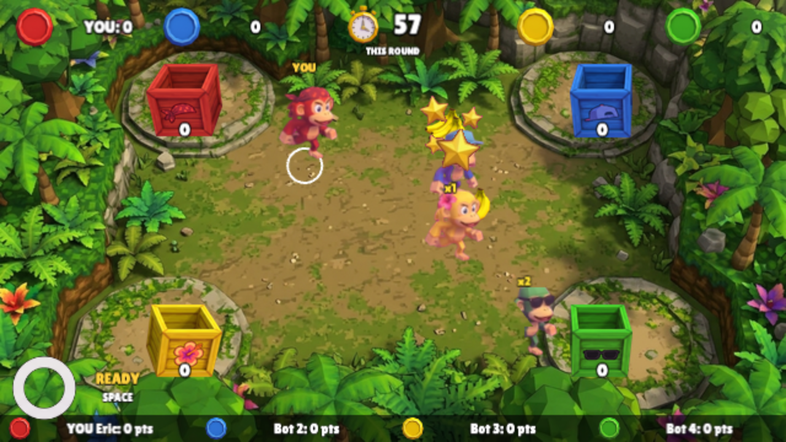

# Monkey Mania II: Primate Party

[](https://github.com/eluong1217/monkey-mania-ii/actions/workflows/ci.yml)

A 4-player online party game for the browser. Make a room, send the link to three friends (or let bots fill the empty seats), and play five rounds of short mini-games. Whoever has the most party points wins.

**Play:** [monkey-mania-ii.gnoule.com](https://monkey-mania-ii.gnoule.com)



## The mini-games

- **Fruit Frenzy:** catch falling fruit, and shove rivals to steal their catch.
- **Coconut Dodge:** dodge coconuts that land on telegraphed shadows, and roll to survive.
- **Banana Heist:** carry bananas to your stash and steal from rivals' corners.
- **King of the Stump:** knock rivals off a shrinking stump, and be the last monkey standing.

Each round has 3 points for 1st, 2 for 2nd, 1 for 3rd, and 0 for 4th. The final round is worth double. Controls are always the same: move with WASD, the arrow keys or a touch stick, and use one action button (Space or tap).

## Run it locally

You need Node 22 (see `.nvmrc`).

```sh
git clone https://github.com/eluong1217/monkey-mania-ii.git
cd monkey-mania-ii
npm ci
npm run dev        # game at http://localhost:5173, server on port 3000
```

Open http://localhost:5173 in a browser, choose **Play**, create a room, and start the match. Empty seats are filled by bots, so one tab is enough to play a full match. To join from another tab or device, open the room link.

To run the production build as a single process instead:

```sh
npm run build
npm start          # http://localhost:3000
```

Other scripts: `npm test` (unit tests), `npm run build`, `npm run lint`.

## How it is built

The game is one TypeScript codebase in three npm workspaces: `packages/shared` (the game rules, deterministic and shared by the server and the client), `packages/server` (Node and `ws`, which runs the authoritative match loop), and `packages/client` (Vite and Phaser). The server decides every outcome and clients only send inputs and draw snapshots. The design contract is in [`docs/DESIGN.md`](docs/DESIGN.md). Deployment notes are in [`docs/DEPLOY.md`](docs/DEPLOY.md).

## History

The original Monkey Mania was a 2018 AP Computer Science project written in Processing. It is kept in [`reference/`](reference/) for history and is read-only.

## Credits and licences

- **Font:** Lilita One by Juan Montoreano, licensed under the SIL Open Font License 1.1 ([`assets/fonts/OFL.txt`](assets/fonts/OFL.txt)). Obtained from the Fontsource package `@fontsource/lilita-one`.
- **Art:** the sprites, backgrounds and UI graphics were generated with Google Gemini (AI-generated, then selected and adjusted by hand). The prompts are in [`tickets/`](tickets/) (the A-tickets).
- **Sound effects and music:** not yet added. Their sources and licences will be listed in `assets/audio/CREDITS.md` when they are.
- **Code:** the repo has no licence file yet.

## Portfolio blurb

Monkey Mania II is a 4-player party game that runs in the browser, with no install. It is built in TypeScript on a single deterministic game simulation shared by an authoritative Node server and a Phaser client, with bots that play under the same rules as people. The art is a deliberately retro early-2000s console look. It began as a 2018 Processing project and is rebuilt here as a networked game.
