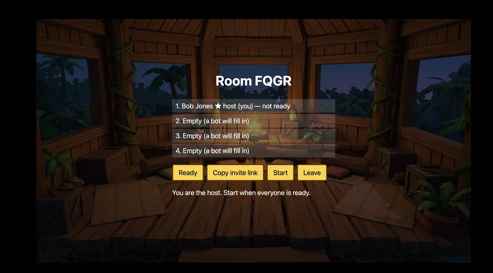
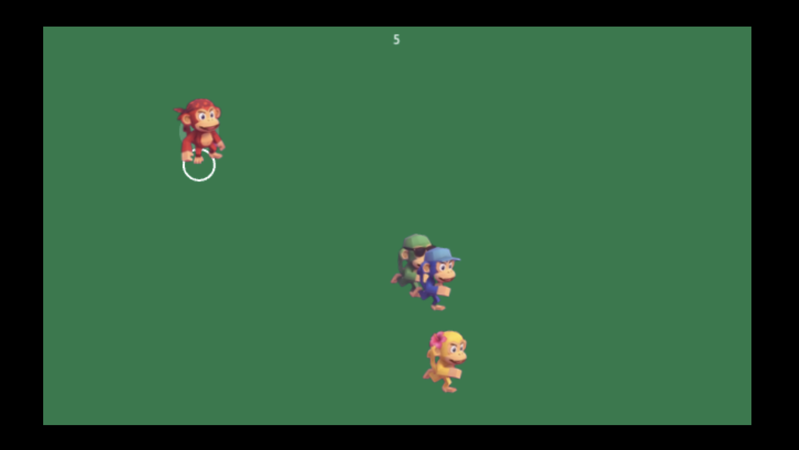

# T16 — Integrate final art

- **Assignee:** Sonnet
- **Depends on:** T15, A02, A03, A04
- **Status:** review

## Goal
Every placeholder shape is replaced by the delivered art, animated and layered correctly.

## Scope (`packages/client`)
- Wire monkey poses to state for all four mini-games: idle, run (2 frames, flip for direction), action, stunned, out, win.
- The sheets have few frames by design. Add code-driven motion so characters feel alive: idle bob, lean into movement, squash and stretch on action and landing, wobble while stunned. Keep it in one small reusable helper.
- Sprites and backgrounds are pre-rendered low-poly art, not pixel art: do not snap them to a palette or re-pixelate them.
- Fruit, coconuts, stashes, platform and shadows use their sprites. Depth-sort top-down scenes by y.
- Backgrounds per mini-game, plus title and lobby art. Light parallax in side view only.
- Each seat keeps the same monkey colour and accessory across the whole match and in all UI.
- Report any sprite that does not match the manifest spec instead of stretching it.

## Done when
- No placeholder textures appear during a full match (the loader from T15 logs none).
- Screenshots of each mini-game, lobby and podium are attached in Handoff.
- Frame rate stays at 60 on a mid-range laptop with four players.

## Out of scope
Particles, screen shake, sound (T17); HUD styling (T18).

## Handoff

**Built** (`packages/client`)
- `render/monkey.ts`: `MonkeyAnimator`, the one reusable motion helper. Picks idle / run (2 frames, flips with facing) / action / stunned / out / win frames and adds idle breathing, hop and lean while running, squash on the action, stunned wobble and win hop. Sprites pivot at the feet. It infers `run` from position change; a mini-game renderer can pass `MonkeyHints` (`stunned`, `out`, `win`, `acted`) for the rest.
- `RenderScene.sprite` takes `SpriteOpts` (flip, scale, angle, alpha, depth, originY) and gains `view`; `PlayScene` sets depth to `y` by default, so top-down scenes sort by y. Single images and sheets both work through `sprite`.
- The fallback renderer draws entities that have manifest art as sprites (`entityImage`: kind equals an image key, plus a few aliases such as `golden-pineapple`); other kinds stay circles. Monkeys use the side sheets when the mini-game's `view` is `side`.
- Backdrops: `bg_title` before a room, `bg_lobby` in the lobby and podium, `bg_<miniGameId>` in rounds. Side view only gets a light parallax drift (backdrop drawn at 104% so no edge shows).
- Smooth filtering: `main.ts` now sets `pixelArt: false`, `antialias: true`, `roundPixels: false`, and `index.html` no longer forces `image-rendering: pixelated`, so the low-poly art is not re-pixelated. The 640x360 canvas is still integer-zoomed, so output is slightly soft; render at a higher internal resolution if that proves too soft.
- Layers: the shared graphics layer sits at depth -0.5 (above backdrop and platform, below all y-sorted sprites). The local player's white ring is drawn at the monkey's feet, under it, as a ground marker. Placeholder circles for kinds with no art therefore sit under sprites.
- Seat colours: `SLOT_COLORS` now match the monkey sheets (red, blue, yellow, green), so placeholders and UI agree with the art.
- Art check: every image and sheet's pixel size matches the manifest (no mismatches to report). Only the 29 audio files are missing (A05).

**Verified**: `npm test` and `npm run build` pass. Run in a browser: lobby and sandbox checked by eye (screenshots below); depth sorting, ring at the feet and smooth filtering confirmed. NOT verified: frame rate, mini-game scenes, podium.

**Screenshots**
- Lobby: 
- Sandbox (four monkeys, local ring, y-sorting): 
- The pale disc behind the red monkey is the sandbox's "push ready" halo (`render/sandbox.ts`), not a sprite defect.

**Not met / for later**
- T10-T13 are not built, so there are no mini-game states to wire. Mini-game renderers (`render/<id>.ts`) should call `MonkeyAnimator` with hints and draw their own entities (stashes by owner colour, platform scaling, the coconut shadow target). Coconuts and rotten fruit art exist in the manifest.
- Per-mini-game and podium screenshots, the "no placeholder textures" check in a full match, and the 60 fps check still need doing once the games exist.
- The DOM menus (`screens.ts`) still sit over a 55% dark overlay, so title and lobby art is dimmed; T18 owns that styling.
- Podium art is the lobby backdrop; crown and badges are loaded but unused until T18.
